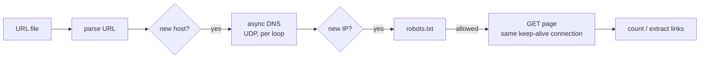

# win-crawl

[](https://github.com/contrafy/win-crawl/actions/workflows/ci.yml)

A high-throughput web crawler for Windows, written in C++20 on raw WinSock:
per-core I/O completion port event loops, a from-scratch async DNS resolver,
HTTP/1.1 keep-alive, Schannel TLS and its own HTML link extractor.

It crawls a 1M-URL seed list in **about 2.7 minutes** on a home connection,
where the original coursework version needed **27**.

## Background

This started as homework 1 of **CSCE 463/612: Networks and Distributed
Processing** at Texas A&M, taught by
[Dr. Dmitri Loguinov](https://irl.cse.tamu.edu/people/dmitri/) of the
[Internet Research Lab](https://irl.cse.tamu.edu/). His group built
[IRLbot](https://irl.cse.tamu.edu/people/hsin-tsang/papers/www2008.pdf)
(WWW 2008, best paper), which crawled 6.3 billion pages from a single server.
The assignment asks students to build the front end of a crawler like that
and push its performance as far as it will go.

The coursework version (one blocking thread per URL, 5000 threads,
`getaddrinfo`, a course-provided HTML parser) is preserved at the
[`legacy-threaded`](https://github.com/contrafy/win-crawl/tree/legacy-threaded)
tag. Everything on `master` is a personal rewrite I keep extending to
experiment with and learn from. It is not a maintained library or product.

## Results

Same machine (Ryzen 7 9700X, 8C/16T, Windows 11, home connection), same
1,000,000-URL seed list (`sample_urls/URL-input-1M.txt`, 824,985 unique
hosts), classic mode, real internet:

| | legacy (5000 threads) | wincrawl, defaults |
|---|---:|---:|
| Wall time | 1,632 s | **159.8 s** (3 runs: 159.8–169.1) |
| URLs/s | 612 | ~6,250 |
| DNS success | 14.0% | 50.4% |
| Sites with robots checked | 40,490 | 114,086 |
| Pages crawled | 12,467 | 34,906 |

About 50% DNS success is the ceiling for this 2015-era list: the other hosts
no longer resolve. The original crawler lost most of the live ones too,
because 5000 concurrent `getaddrinfo` calls overwhelm the home router's
resolver. Finding more hosts alive accounts for the 2.8× in pages crawled.

The home router, not the crawler, sets the limit now. It tops out around
25,000 packets/s, and a classic crawl needs about 3.8 packets per URL, which
puts the floor near 150 s. Raising `-c` or `--dns-inflight` doesn't make it
faster, and a local Unbound resolver is 2–6× slower than 1.1.1.1. Details:
[`bench/results/internet-tuning.md`](bench/results/internet-tuning.md).

Real mode (https, redirects, RFC 9309 robots.txt) handled the same list in
309–422 s: ~73K pages, ~4 GB and ~3.8M links, with ~34K redirects followed.
It also doubles as a measurement instrument. In the 2026 study of this list,
47% of completed TLS handshakes negotiated post-quantum X25519MLKEM768
(of TLS 1.3 handshakes: 99% behind Cloudflare, 38% elsewhere), and ECH in DNS turned out to be essentially
Cloudflare-only. Full write-up:
[what the 2015 web looks like in 2026](docs/study-2026.md).

On the loopback benchmark rig (200K synthetic URLs, no network variance)
wincrawl sustains ~10.7K URLs/s, against 1.2–1.3K for the original. It also
uses 12–14× less CPU (≈115 CPU-seconds vs ≈1,350–1,600) and leaves no
TIME_WAIT sockets behind. CPU profiles show 97% of that CPU is Windows
kernel connection setup; wincrawl's own code is about 3%
([`docs/profiling.md`](docs/profiling.md)).
Details: [`bench/README.md`](bench/README.md) and
[`bench/results/`](bench/results/).

## How it works



- **One IOCP event loop per core, sharing nothing.** Each loop owns its
  sockets, timers, task slots and DNS resolver, so the hot path takes no
  locks. Loops share only an atomic cursor into the memory-mapped URL file
  and two sharded dedupe sets.
- **Own DNS resolver** over UDP with retries, server rotation, EDNS0 and an
  in-flight cap; it also looks up HTTPS records (RFC 9460). Defaults to
  1.1.1.1 / 1.0.0.1, which hold ~9–11K lookups/s where the home router
  collapses past a few hundred.
- **Keep-alive robots + page.** One connection (and, in real mode, one TLS
  handshake) per site instead of two.
- **Own parsers:** incremental HTTP/1.1 response parser (chunked decoded in
  place), RFC 3986 URL resolution, RFC 9309 robots.txt, and a `memchr`-driven
  link extractor at ~3.5 GB/s.
- **Two modes.** `classic` keeps the assignment's rules (HEAD robots, crawl
  only if robots answers 4xx). `real` crawls http and https, honours
  robots.txt per RFC 9309, follows redirects, verifies certificates offline
  via Schannel, and offers post-quantum key exchange (X25519MLKEM768).
- **Measurement mode.** `--record` writes one JSON line per site: DNS, TLS
  version and key exchange group, HTTP/3 and HSTS advertisement, and whether
  the site is behind Cloudflare. `tools/study/analyze.py` turns the records
  into a report.

The full write-up, with measurements behind each decision, is in
[`docs/design.md`](docs/design.md).

## Building

Requirements: Windows 10/11 x64, Visual Studio 2022 or 2026 with the
"Desktop development with C++" workload (MSVC, CMake, Ninja, Windows SDK).

From a Developer PowerShell / x64 Native Tools prompt:

```powershell
cmake --preset release
cmake --build --preset release
ctest --preset release
```

From any shell, `tools\vsdev.cmd` finds Visual Studio and runs a command
inside its environment:

```powershell
tools\vsdev.cmd cmake --preset release
tools\vsdev.cmd cmake --build --preset release
```

The binary lands at `build\release\wincrawl.exe`.

## Usage

```powershell
# the assignment pipeline over the 1M seed list
build\release\wincrawl.exe sample_urls\URL-input-1M.txt

# real-world crawl: https, redirects, RFC 9309 robots.txt
build\release\wincrawl.exe --mode real sample_urls\URL-input-1M.txt

# measurement run: per-site records + HTTPS DNS records, then the report
build\release\wincrawl.exe --mode real --record study.jsonl --https-rr sample_urls\URL-input-1M.txt
python tools\study\analyze.py study.jsonl --seeds 1000000 > study.md

# machine-readable results
build\release\wincrawl.exe --json run.json --quiet sample_urls\URL-input-100.txt
```

`wincrawl --help` lists every option. The most useful ones:

| Option | Default | |
|---|---|---|
| `--mode classic\|real` | classic | pipeline rules (see above) |
| `-c, --concurrency N` | 4000 | URLs in flight across all loops |
| `-t, --threads N` | logical CPUs | event loops |
| `--dns ADDR[:PORT],…` | 1.1.1.1,1.0.0.1 | `--dns system` uses the OS servers |
| `--dns-inflight N` | 2048 | outstanding DNS queries in total |
| `--timeout MS` | 10000 | per fetch, connect included |
| `--no-keepalive` | | original HTTP/1.0, new connection per request |
| `--insecure` | | real mode: skip certificate verification |
| `--no-pq` | | real mode: don't offer post-quantum key exchange |
| `--record FILE` | | one JSON line per site ([schema](docs/study-method.md)) |
| `--https-rr` | | also look up each host's HTTPS DNS record (needs `--record`) |

Progress uses the course's status line format, printed every 2 s:

```
[ 98]  12000 Q  436181 E  563819 H 563819 D 271893 I 80915 R 26285 C 25304 L  868K
      *** crawling 68.0 pps @ 10.6 Mbps
```

Reading left to right: elapsed seconds, then URLs in flight. Then:

- `Q`: URLs not yet started
- `E`: URLs extracted from the file
- `H`: unique hosts
- `D`: successful DNS lookups
- `I`: unique IPs
- `R`: robots checks passed
- `C`: pages crawled
- `L`: links found, in thousands

## Running it on your machine

- **Ports.** Windows gives outbound connections 16,384 ephemeral ports
  machine-wide. Stay below ~12K concurrency, or widen the range (admin):
  `netsh int ipv4 set dynamicport tcp start=10000 num=55535`.
- **Certificates (real mode).** Verification never fetches anything over the
  network, so roots Windows hasn't downloaded yet fail. Load them all once
  (admin):
  `certutil -generateSSTFromWU roots.sst` then
  `Import-Certificate -FilePath roots.sst -CertStoreLocation Cert:\LocalMachine\Root`.
  Or pass `--insecure`.
- **Post-quantum TLS.** Windows enables the hybrid ML-KEM groups machine-wide
  only (admin): `Enable-TlsEccCurve -Name X25519_MLKEM768 -Position 0`, undo
  with `Disable-TlsEccCurve -Name X25519_MLKEM768`. See
  [`docs/tls-notes.md`](docs/tls-notes.md).
- **DNS etiquette.** A 1M run sends ~900K queries to the configured
  resolvers. Point `--dns` at a resolver you're entitled to load that hard.
- **Your household network.** At the defaults a 1M crawl saturates a typical
  home router (other devices see web latency rise from ~0.08 s to ~0.5 s;
  real mode is worse). `--dns-inflight 1024` keeps it responsive at ~25% lower
  speed.

## Repository layout

| Path | |
|---|---|
| `src/net/` | IOCP loop, timers, async TCP/UDP sockets |
| `src/dns/` | DNS wire codec, system server discovery, async resolver |
| `src/tls/` | Schannel client session (buffers in, buffers out) |
| `src/parse/` | URL, HTTP/1.1, link extraction, robots.txt |
| `src/crawl/` | engine, connection layer, dedupe, stats, CLI config |
| `src/benchsrv/` | fake DNS + HTTP servers for tests and benchmarks |
| `apps/wincrawl/` | the crawler |
| `apps/benchd/` | `wincrawl-benchd`: benchmark servers, URL generator, load generator |
| `fuzz/` | libFuzzer targets, seed corpora and dictionaries |
| `tools/study/` | measurement study analyzer |
| `tools/profile/` | ETW stack folding and flame graph rendering |
| `bench/` | benchmark scripts, Unbound configs, notes and results |
| `docs/` | design notes, study, profiling, fuzzing, roadmap |
| `data/` | Cloudflare IPv4 ranges (compiled in) |
| `sample_urls/` | the course's 100 and 1M-URL seed lists |

Unit and loopback end-to-end tests (doctest, vendored under `third_party/`)
run in CI on every push, together with 60 s of fuzzing per parser under
AddressSanitizer ([`docs/fuzzing.md`](docs/fuzzing.md)).

## What's next

See [`docs/roadmap.md`](docs/roadmap.md). Next up: per-IP politeness (so
studies can cover every host, not one per IP), Web Bot Auth request signing,
the CPU savings the profiles point to, and a Linux io_uring backend.
