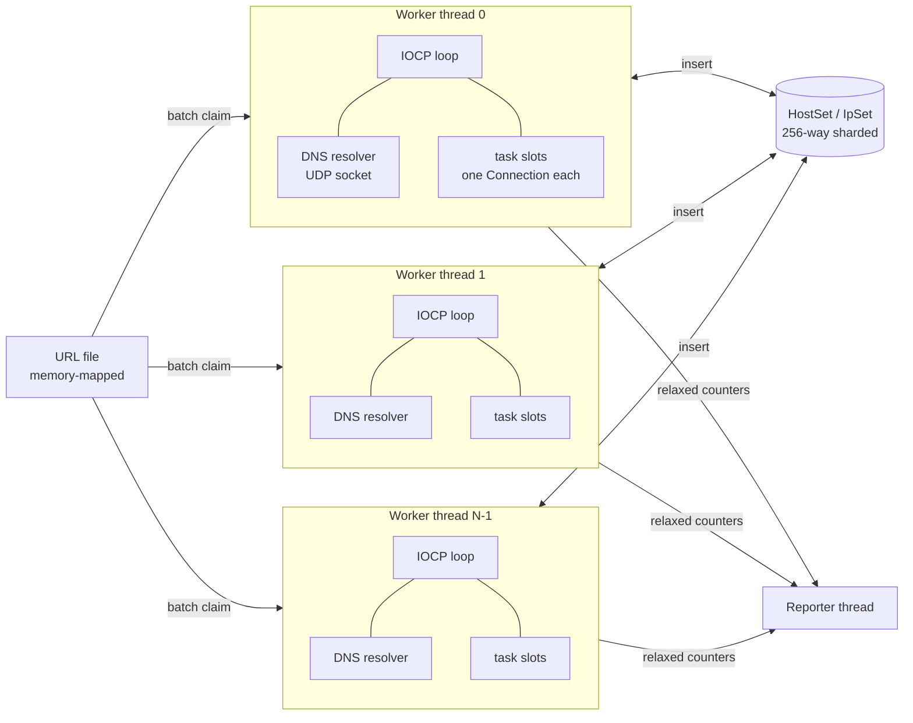

# Design notes

How wincrawl is put together and why. The README covers building and
running it; this file covers the engineering decisions and the measurements
behind them.

## Where it came from

The original assignment (CSCE 463, homework 1) is a crawler that reads a list
of seed URLs and, for each one:

1. parses the URL,
2. skips it unless its host has not been seen before,
3. resolves the host,
4. skips it unless the IP has not been seen before,
5. sends `HEAD /robots.txt` (16 KB cap) and continues only if robots answers 4xx,
6. downloads the page (2 MB cap, 10 s) and counts its links.

The coursework version used one blocking thread per URL (5000 threads),
`getaddrinfo` for DNS, and a course-provided closed-source HTML parser. It is
preserved at the `legacy-threaded` tag.

## What limited the original

Profiling the original on the 1M-URL seed file showed it was not CPU-bound at
all. Three things held it back:

- **DNS collapse under concurrency.** 5000 threads calling `getaddrinfo` all
  funnel into the OS DNS client and the home router's resolver. Only 14% of
  lookups succeeded over the full run. Measured with our own resolver, the
  router answers ~50% of these hosts at 64 queries in flight but only ~15% at
  4096; the rest time out. During the run the machine could not even resolve
  github.com.
- **Blocking connect.** `SO_SNDTIMEO` does not apply to `connect()`, so a dead
  IP could hold a thread for ~21 s of SYN retries.
- **Thread-per-URL.** 5000 threads each blocked on one socket at a time is a
  lot of stacks and context switches for very little concurrency per thread.

## Engine

- **Share-nothing loops** (`src/net/loop.h`). One I/O completion port per
  worker thread. Everything a loop owns (sockets, timers, task state, its DNS
  resolver) is touched only on that thread, so the hot path has no locks. The
  only shared state is the URL cursor (one atomic) and the host/IP sets.
- **Completion contract** (`src/net/tcp.h`). Every operation completes exactly
  once on the loop thread, never inline, including after `close()` (as
  `ERROR_OPERATION_ABORTED`). Timeouts are loop timers that `close()` the
  socket. This one rule is what makes task-slot recycling safe: a slot is
  reused only once its connection has nothing outstanding.
- **Timers** are an indexed binary heap with generation-tagged ids, so cancel
  is O(log n) and a stale id is a no-op. A crawl arms and cancels several
  timers per URL.
- **Task pipeline** (`src/crawl/engine.cpp`). Each slot runs one URL through
  parse → host dedupe → DNS → IP dedupe → robots → page → link count, then
  claims the next URL. Workers claim only as many URLs as they have free
  slots, so no loop hoards a backlog while others sit idle at the end.
- **Keep-alive.** The robots request and the page request share one HTTP/1.1
  connection when the server allows it, saving a TCP handshake (and, in real
  mode, a TLS handshake) per site. `--no-keepalive` restores the original
  HTTP/1.0 + `Connection: close` behaviour for comparison.
- **Dedupe.** Hosts are stored as 64-bit hashes in 256 SRWLOCK-guarded
  open-addressing shards; for ~825K hosts the chance of any collision is about
  2e-8. IPs are stored exactly.
- **Stats.** Each loop writes its own cache-line-aligned counter block with
  relaxed atomic load+store (no `lock` prefix); a reporter thread sums them
  every interval. The status line keeps the course's format.

## DNS

`src/dns/` is a from-scratch async resolver: one UDP socket per loop, random
transaction ids, replies accepted only from a configured server with a
matching id and question, per-attempt timers, retries rotated across servers,
and a FIFO once the in-flight cap is reached. The wire codec is bounds-checked
against compression loops and truncated packets and fuzzed in the tests.

Measured on this dataset (one loop, 1500 ms × 3 attempts):

| Servers | In flight | OK | Timeout | Steady lookups/s |
|---|---|---|---|---|
| Home router | 64 | 49.7% | 0.8% | 272 |
| Home router | 4096 | 14.9% | 70.6% | 599 |
| 1.1.1.1 + 1.0.0.1 | 4096 | 50.3% | 0.3% | 11,809 |
| 8.8.8.8 + 8.8.4.4 | 4096 | 50.7% | 0.2% | 10,580 |

About 50% is the ceiling for this 2015-era seed list: ~38% of the hosts are
NXDOMAIN today and ~11% have no A record. Public resolvers hold that ceiling
at thousands of lookups per second, so they are the default
(`--dns 1.1.1.1,1.0.0.1`, 2048 in flight). `--dns system` uses the OS servers
and caps itself at 64 in flight.

## HTTP, links and robots

- **Response parser** (`src/parse/http.h`). Incremental over a caller-owned
  buffer, storing offsets rather than pointers so the buffer can grow between
  calls. Handles Content-Length, chunked (decoded in place into one
  contiguous body), close-delimited bodies, HEAD, 1xx interim replies, and a
  raw-byte size cap. Rejects anything that does not start with `HTTP/1.x`;
  the original crawler crashed on such replies.
- **Link extractor** (`src/parse/links.h`). Replaces the course's closed-source
  parser. It scans for `<` with `memchr`, parses only `<a>`, `<area>` and
  `<base>`, skips comments, `<script>` and `<style>`, decodes character
  references, and resolves refs per RFC 3986. Count-only extraction runs at
  about 3.5 GB/s on a 59-page real-world corpus, roughly 2× the course parser
  on the same pages. On http-only links it agrees with the course parser
  page-for-page on 41 of 59 pages. The differences are deliberate: the course
  parser drops https links, ignores `<base>`, and counts empty hrefs, frames
  and meta refreshes.
- **robots.txt** (`src/parse/robots.h`). RFC 9309 group selection, `*` and `$`
  wildcards, longest match wins, Allow wins ties. Used only by real mode;
  classic mode keeps the assignment's "4xx means no robots file" rule.

## TLS (real mode)

`src/tls/` is a Schannel client session that is pure buffers in, buffers out,
so the crawler drives it from IOCP completions. TLS 1.2 and 1.3 with SNI, one
shared credential handle. Certificate checks (`Verify::Chain`) build the chain
from the local store only and never fetch over the network, so a loop thread
can never block on certificate downloads. Consequence: a site whose root
certificate Windows has not downloaded yet fails verification. Pre-load the
roots once with `certutil -generateSSTFromWU roots.sst` and import them, or
use `--insecure`.

Schannel quirks the connection layer handles: TLS 1.3 session tickets surface
as `SEC_I_RENEGOTIATE` after the handshake; close_notify arrives as
`SEC_I_CONTEXT_EXPIRED`; and some servers (google.com) send a TCP FIN with no
close_notify at all, so HTTP framing, not TLS, decides whether a reply was
complete.

## Windows limits worth knowing

- **Ephemeral ports.** Every outbound socket holds a unique local port, and the
  default dynamic range is 16,384 ports machine-wide. `SO_REUSE_UNICASTPORT`
  is set but is not honoured on a stock machine. Keep `--concurrency` well
  under ~12K, or widen the range (admin):
  `netsh int ipv4 set dynamicport tcp start=10000 num=55535`.
  When ports do run out, wincrawl backs off and retries the step instead of
  dropping the URL (`port_exhaustion` in the stats).
- **TIME_WAIT.** wincrawl closes connections abortively once a reply is
  framed, so it leaves no TIME_WAIT behind. Close-per-request clients that
  read to EOF (like the original crawler) make the server own TIME_WAIT,
  which lasts 120 s here and, on loopback, pins client ports too.
- **Refused connects** take ~2 s because Windows retries the SYN;
  `--connect-timeout` (default 5 s) bounds the cost.
- **The 2026 web vs. a 2015 seed list.** Most `http://` sites now redirect to
  https, including `robots.txt`. Classic mode keeps the assignment's rules, so
  a 3xx on robots means "skip". Real mode follows redirects into TLS and
  honours robots.txt properly.
