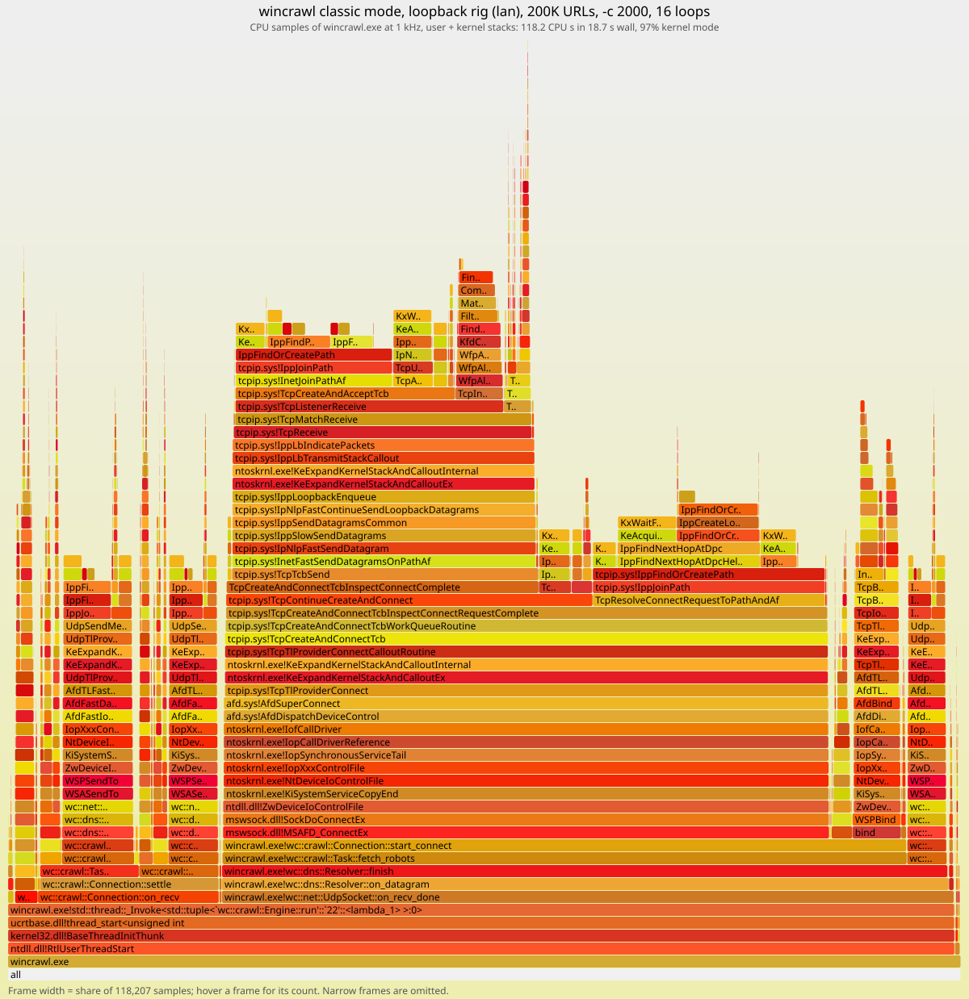
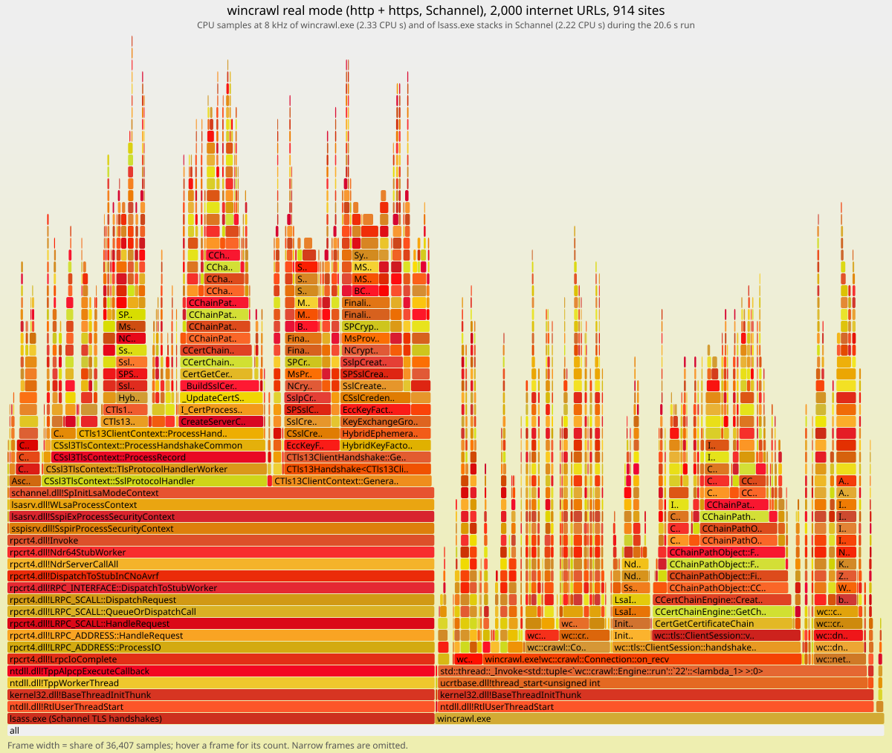

# CPU profiling

Where wincrawl spends CPU, measured with ETW sampling (kernel + user stacks) on the
dev box, and what that says about where the next gains are. Everything below was
captured on 2026-11-21 at `42e2b5f` (Ryzen 7 9700X 8C/16T, Windows 11 26200, 32 GB,
TCP dynamic port range 10000-65535). Other jobs (builds, crawls) were running on the
machine at the same time, so every number here is for one process (by PID), never
machine-wide.

## Summary

- **Classic mode on the loopback rig is a Windows TCP connection-setup benchmark.**
  97% of the crawler's CPU is kernel mode. `ConnectEx` alone is 63.5% of it and DNS
  `sendto` another 16.6%. Inside the kernel the IPv4 path cache dominates:
  `tcpip!IppFindOrCreatePath` is on 52% of all samples, and 36% of all samples are
  spinning in `ntoskrnl!KxWaitForLockOwnerShip`, mostly on the path-set and next-hop
  locks. wincrawl's own code (parsers, link extractor, dedupe, timers, allocation)
  is about 3%.
- **Real mode is dominated by TLS, and half of TLS runs in another process.**
  Schannel does the handshake in `lsass.exe` (over LRPC). lsass's Schannel stacks
  used as much CPU (2.22 s) as the whole crawler process (2.33 s) in the same run.
  Inside wincrawl, certificate chain verification is the top item (33%), then socket
  create/bind/close (22%). Ephemeral key generation for the ClientHello key shares
  (the X25519MLKEM768 hybrid plus a separate NIST-curve share) is the top item
  inside lsass (32%).
- **A connected UDP socket is the cheapest win.** Under rig load an unconnected
  `sendto` cost 88-96 µs of CPU per DNS query, a connected `send` 6-7 µs. That is
  about 15% of the classic-mode crawler CPU on the rig.
- Defender for Endpoint (`MsSense.exe`) went from 0.05 to about 1.5 cores while the
  rig crawl ran. That is about 25% extra CPU on top of the crawler, spent watching
  the connections.

| Top hotspots, classic rig (share of wincrawl samples) | % |
|---|---:|
| `MSAFD_ConnectEx` (incl. loopback SYN/accept processing done inline) | 63.5 |
| `tcpip!IppFindOrCreatePath` (inclusive: destination path lookup/creation) | 51.9 |
| `ntoskrnl!KxWaitForLockOwnerShip` (self: spinning on queued spinlocks) | 36.1 |
| `WSASendTo` (DNS queries) | 16.6 |
| WFP ALE classification (`WfpAle*`, inclusive) | 13.1 |
| `IppCreateLocalAddress` (loopback-only: an ephemeral local address per 127.x.y.z) | 8.3 |
| `bind(0)` | 4.9 |
| user mode, all of it | 3.0 |
| `LinkExtractor::extract` (inclusive, 2.05M links from 2.17 GB) | 0.5 |

| Top hotspots, real mode (share of wincrawl samples unless noted) | % |
|---|---:|
| `CertGetCertificateChain` in `verify_peer` (57.7% of it is signature checks) | 33.1 |
| socket lifecycle: `bind` 9.4, `closesocket` 7.1, `WSASocketW` 3.6, `setsockopt` 1.8 | 22.1 |
| `InitializeSecurityContext` client side (LRPC to lsass) | 11.2 |
| TCP send / connect / recv | 6.8 / 5.2 / 2.9 |
| TLS record decryption (`DecryptMessage`, AES-GCM) | 1.7 |
| link extraction + URL resolution / robots.txt / HTTP parsing | 0.7 / 0.5 / 0.5 |
| lsass: `SPSslCreateEphemeralKey` (share of lsass Schannel samples) | 32.3 |
| lsass: `CertGetCertificateChain` from `I_CertProcessSslHandshake` (same) | 18.9 |
| lsass: `SPSslImportKey` (peer key shares) / `BCryptVerifySignature` (same) | 11.6 / 8.7 |

## Capturing

### Build with symbols

An optimized build with PDBs, in `build/profile`, without touching the presets
(LTCG stays on, as in `release`):

```powershell
tools\vsdev.cmd cmake -S . -B build/profile -G Ninja -DCMAKE_CXX_COMPILER=cl `
  -DCMAKE_BUILD_TYPE=Release -DCMAKE_MSVC_DEBUG_INFORMATION_FORMAT=ProgramDatabase `
  "-DCMAKE_EXE_LINKER_FLAGS_RELEASE=/DEBUG /OPT:REF /OPT:ICF /INCREMENTAL:NO" `
  -DWINCRAWL_BUILD_TESTS=OFF
tools\vsdev.cmd cmake --build build/profile
```

### Workloads

```powershell
$b = 'build\profile'
# (a) loopback rig, classic mode, lan profile, 200K URLs
& "$b\apps\benchd\wincrawl-benchd.exe" gen --count 200000 --port 28080 --out $env:TEMP\rig-urls.txt
& "$b\apps\benchd\wincrawl-benchd.exe" serve -t 4 --profile lan --http 0.0.0.0:28080 --dns 127.0.0.1:25300   # second shell
& "$b\wincrawl.exe" --dns 127.0.0.1:25300 -c 2000 -q --json rig.json $env:TEMP\rig-urls.txt

# (b) real mode over the internet: every 500th line of the 1M seed list = 2,000 URLs
Get-Content sample_urls\URL-input-1M.txt | Where-Object { ($script:i++ % 500) -eq 0 } | Set-Content $env:TEMP\real-urls.txt
& "$b\wincrawl.exe" --mode real -c 2000 --json real.json $env:TEMP\real-urls.txt
```

To get the PID (for filtering) and the process's own user/kernel CPU split, start
the crawler through `Start-Process`:

```powershell
$p = Start-Process "$b\wincrawl.exe" -ArgumentList '--mode real -c 2000 -q real-urls.txt' -NoNewWindow -PassThru
$null = $p.Handle; $p.WaitForExit()
"pid $($p.Id) user $($p.UserProcessorTime.TotalSeconds) s kernel $($p.PrivilegedProcessorTime.TotalSeconds) s"
```

### Recording (elevated)

Kernel sampling needs an elevated shell. Record only samples, process/image events
and sample stacks:

```powershell
# optional: 8 kHz instead of the default 1 kHz (units of 100 ns); restore afterwards
wpr -setprofint 1250
xperf -on PROC_THREAD+LOADER+PROFILE -stackwalk Profile -BufferSize 1024 -MinBuffers 256 -MaxBuffers 1024 -f $env:TEMP\kernel.etl
#   ... run the workload ...
xperf -stop
xperf -merge $env:TEMP\kernel.etl rig.etl     # adds the image/PDB identities symbol decoding needs
wpr -setprofint 10000
```

Do not use `wpr -start CPU` here. That profile also records context switches and
ready-thread events with stacks. At ~7K new connections/s it wrote 4 GB in 19 s and
still dropped 10.4M events. The lean session above wrote 103 MB (rig, 1 kHz) and
576 MB (real mode, 8 kHz, whole machine) with no losses. The 1 kHz rig capture cost
about 2% CPU (116.1 vs 113.7 CPU s). At 8 kHz, stack walking is expensive enough to
inflate the sampled process's CPU (2.29 s traced vs 1.31-1.33 s untraced for the
same real-mode input). So treat the 8 kHz shares as accurate and its absolute
seconds as inflated.

### Decoding, folding, rendering (no elevation)

```powershell
$env:_NT_SYMBOL_PATH = "cache*$env:TEMP\sym;$PWD\build\profile;srv*$env:TEMP\sym*https://msdl.microsoft.com/download/symbols"
xperf -i rig.etl -symbols -a dumper -stacktimeshifting -o rig.txt
python tools\profile\fold.py rig.txt --pid <wincrawl pid> -o rig.folded --report
python tools\profile\flamegraph.py rig.folded -o docs\img\flame-rig-classic.svg `
  --title "wincrawl classic mode, loopback rig (lan), 200K URLs, -c 2000, 16 loops" `
  --subtitle "CPU samples of wincrawl.exe at 1 kHz, ..."
```

- `xperf -a dumper -stacktimeshifting` prints every `SampledProfile` event followed
  by its merged kernel+user stack. The first decode downloads PDBs for every image
  in the trace (about 2 GB, 17 minutes here). After that, decoding is limited by
  dumping speed: 0.9 GB of text for the rig trace and 6.4 GB for the 8 kHz real
  trace. `xperf -a stack` only offers a butterfly view, and the WPA exporter needs
  a hand-written `.wpaProfile`, so neither was used.
- `tools/profile/fold.py` streams the dump and keeps the samples of the selected
  processes (`--pid`, `--process REGEX`, `--range LO_US HI_US`). It writes folded
  stacks (`process;outer;...;leaf count`, root first, one line per unique stack).
  `--report` prints samples per process, the user/kernel split (by the sampled
  instruction pointer), and top modules and functions by self and inclusive
  samples. Pass `--hz 8000` when the interval was 1250.
- `tools/profile/flamegraph.py` turns folded stacks into a static SVG. It has no
  scripts, so it renders on GitHub. It uses the classic hot palette, hashed per
  function name, on the classic light background, so it reads the same in light and
  dark themes. Each frame has a `<title>` tooltip with its count and share. Frames
  narrower than `--min-px` are dropped to keep the file small. Both tools are
  stdlib-only Python.
- The real-mode graph combines two processes. The commands were the crawler's PID
  plus lsass restricted to the crawl window and to stacks that pass through
  `schannel.dll`:

  ```powershell
  python tools\profile\fold.py real.txt --hz 8000 --pid <pid> -o real-wc.folded --report
  python tools\profile\fold.py real.txt --hz 8000 --process '^lsass\.exe$' --range 4000000 26000000 -o real-lsass.folded --report
  (Get-Content real-wc.folded) + ((Select-String schannel.dll real-lsass.folded).Line -replace '^lsass\.exe;', 'lsass.exe (Schannel TLS handshakes);') | Set-Content real.folded
  python tools\profile\flamegraph.py real.folded --min-px 1.5 -o docs\img\flame-real-tls.svg --title ...
  ```

## Classic mode on the loopback rig



Workload (a): 200,000 URLs, 179,960 unique hosts, 161,949 resolved, 129,488 unique
IPs, which means 129,488 TCP connections. Then 77,550 pages, 2.17 GB and 2.05M
links. Run with `-c 2000` and 16 loops. `wincrawl-benchd serve -t 4` ran on the
same machine.

| | untraced | traced (1 kHz) |
|---|---:|---:|
| wall | 18.61 s | 18.77 s |
| user / kernel CPU | 3.11 s / 110.55 s | 3.61 s / 112.52 s |
| samples | | 118,207 (97.0% kernel, 3.0% user) |
| CPU per URL / per connection | 0.57 ms / 0.88 ms | |
| user-mode CPU per URL | 16 µs | |

Where the samples go, by the first user-mode API under the system call:

| API | % of samples |
|---|---:|
| `ConnectEx` | 63.5 |
| `WSASendTo` (DNS queries) | 16.6 |
| `bind` | 4.9 |
| `closesocket` | 3.5 |
| `WSASend` (HTTP requests) | 3.3 |
| `WSPSocket` (socket creation) | 1.9 |
| `setsockopt` (incl. `SO_UPDATE_CONNECT_CONTEXT`) | 0.7 |
| `GetQueuedCompletionStatusEx` | 0.5 |
| `WSARecv` / `WSARecvFrom` | 0.5 / 0.4 |
| user mode (everything else) | 3.0 |

What happens inside `ConnectEx` on loopback:

- **Loopback runs the peer's work in the caller's thread.** `ConnectEx` sends the
  SYN, and the loopback path delivers it inline: the server's
  `TcpListenerReceive` → `TcpCreateAndAcceptTcb`, which is 28.2% of all crawler
  samples, runs in the crawler's thread. So part of the accept work is billed to
  the client. On the internet this cost does not exist.
- **The path cache.** Each new destination address needs an IP path (route, next
  hop, local address) from tcpip's path cache. `IppFindOrCreatePath` is on 51.9%
  of samples and `IppFindPath` on 26.0%. Self time sits in hash-chain walks
  (`IppFindPath` 6.5%, `tcpip!memcmp` 6.1%, `RtlGetNextEntryHashTable` 3.1%,
  `IppFindPathUnderLock` 2.4%). The path set holds one entry per destination. The
  rig crawls 129K different 127.x.y.z addresses (a real crawl also has ~112K
  distinct IPs per 1M seeds), and lookups get slower as the table grows.
- **Lock contention.** 36.1% of all samples spin in `KxWaitForLockOwnerShip`.
  The locks are: next hop (`IppFindNextHopAtDpc` 6.3%), path lookup for UDP sends
  (4.1%), TCP connects (3.8%), the accept side (3.1%, 1.6%), and path info for SYN
  options and RTT setup (`IppGetNextHopFromPath`, 4.2 + 3.2 + 1.4%). This share
  stays at 33-37% from the first second of the run to the last, so it is
  contention, not table growth.
- **Loopback-only local addresses.** `IppCreateLocalAddress` creates an ephemeral
  local address for each new 127.x.y.z destination (8.3%). This is an artifact of
  the rig's address plan.
- WFP ALE classification is 13.1% inclusive, and pool allocation 2.4%. ETW event
  writes are 1.8%: some consumer (Defender for Endpoint, see below) has the
  AFD/TCPIP providers enabled.

More loops do not buy much, because the lock is the limit. The same input with `-t`
(untraced):

| `-t` | wall s | crawler CPU s | URLs/s |
|---:|---:|---:|---:|
| 2 | 39.36 | 77.7 | 5,081 |
| 4 | 25.30 | 97.9 | 7,905 |
| 8 | 20.49 | 116.8 | 9,761 |
| 16 | 18.61-19.76 | 113.7-117.4 | 10,121-10,747 |

The server (`wincrawl-benchd`, 32.5 CPU s in the same trace) has the same profile:
93.5% kernel, 21.9% `KxWaitForLockOwnerShip`, 13.9% `IppFindPath`.

**User mode** (3,575 samples, 3.0% of the total):

| | % of user | % of all |
|---|---:|---:|
| Winsock/ntdll user-mode stubs | 32.7 | 1.0 |
| DNS resolver and codec | 17.9 | 0.5 |
| engine, connection, loop dispatch | 13.5 | 0.4 |
| URL parse/resolve (`resolve_impl`, `append_path`) | 13.4 | 0.4 |
| link extraction | 6.8 | 0.2 |
| heap allocate/free | 6.0 | 0.2 |
| timers (`add_timer`/`cancel_timer`/heap) | 3.5 | 0.1 |
| HTTP response parser | 3.4 | 0.1 |
| host/IP dedupe sets | 2.7 | 0.1 |

The link extractor's whole inclusive cost was 577 samples: 0.58 s for 2.05M links in
2.17 GB, about 3.7 GB/s, which matches the corpus benchmark in the design notes.
Nothing in user mode is worth optimizing for throughput.

### Why DNS `sendto` is expensive here

`WSASendTo` took 19,608 samples for 179,960 queries, about 109 µs per query.
An unconnected UDP socket goes through `UdpSendMessages` → `IppJoinPath` →
`IppFindOrCreatePath`, which means a path-cache lookup under the contended lock,
for every datagram (`IppJoinPath` is 11.0% of all samples). A connected socket
keeps its path on the endpoint. A throwaway micro-benchmark measured both: 4
threads, 20,000 × 40-byte datagrams each to a loopback sink.

| conditions | unconnected `sendto` | connected `send` |
|---|---:|---:|
| idle machine, 16 threads | 7.55-7.92 µs CPU/send | 7.22-7.42 µs |
| idle machine, 1 thread | 4.69 µs | 4.80 µs |
| while a rig crawl runs (3 runs) | 87.5-95.9 µs | 6.05-6.64 µs |

On a quiet stack the two are the same. Under load, the per-datagram path lookup is
13-15× more expensive.

## Real mode (TLS)



Workload (b): 2,000 URLs, every 500th line of `URL-input-1M.txt`. Run with `--mode
real -c 2000`, 16 loops, DNS 1.1.1.1. In the traced run: 1,911 hosts, 1,083
resolved, 914 sites attempted, 652 pages, 435 redirects followed, 59.9 MB, 41K
links, 20.6 s wall (network-bound: the last ~10 s were stragglers).

| | value |
|---|---:|
| wincrawl, traced (8 kHz): samples | 18,660 = 2.33 CPU s (52.9% kernel) |
| lsass.exe Schannel stacks in the crawl window | 17,747 = 2.22 CPU s (78% of lsass's samples there) |
| wincrawl untraced, cert verification on (2 runs) | 1.33 / 1.31 CPU s (user 0.56 / 0.61) |
| wincrawl untraced, `--insecure` (2 runs) | 1.13 / 1.04 CPU s |
| CPU per URL / per site attempted, untraced crawler only | 0.66 ms / 1.45 ms |

`InitializeSecurityContext` is a synchronous LRPC call into lsass
(`sspicli` → `rpcrt4` → `lsasrv!SspiExProcessSecurityContext` →
`schannel!SpInitLsaModeContext`). The loop thread waits while lsass runs the
handshake crypto. So the CPU cost of a TLS crawl is about twice what the crawler's
own process time shows. This is from the traced ratio of lsass to crawler,
2.22 : 2.33; lsass was not measured untraced.

Inside wincrawl (18,660 samples):

| | % | notes |
|---|---:|---|
| certificate chain build + policy (`verify_peer`) | 33.1 | 57.7% signature verification (P-384/P-256 ECDSA, RSA), 35.7% certificate-store lookups and string compares |
| socket create/bind/close/setsockopt | 22.1 | `bind(0)` alone 9.4%: WFP permitted-port scan (`FindPermittedPorts`) and `fse.sys` port-pool reservations; `closesocket` 7.1% |
| `InitializeSecurityContext`, client side of the RPC | 11.2 | |
| TCP send / connect / recv | 6.8 / 5.2 / 2.9 | |
| DNS | 2.7 | |
| IOCP wait/dispatch | 2.5 | |
| TLS decryption (`DecryptMessage`, AES-GCM) | 1.7 | 60 MB |
| link extraction + URL resolution, robots.txt parser, HTTP parser | 0.7, 0.5, 0.5 | |

Inside lsass (17,747 Schannel samples):

| | % |
|---|---:|
| `SPSslCreateEphemeralKey`: generating the ClientHello key shares | 32.3 |
|   of which: curve parameter loading/validation (`LoadCurveInUserMode`, `TestIfNistDomainParameters`) | 30.0 of it |
|   X25519 scalar multiplication | 26.7 of it |
|   NIST curve scalar multiplication | 18.8 of it |
|   ML-KEM-768 key generation (Keccak, NTT) | 13.0 of it |
| `CertGetCertificateChain` called by Schannel (`I_CertProcessSslHandshake`) | 18.9 |
| `SPSslImportKey`: the server's key share (incl. hybrid) | 11.6 |
| `BCryptVerifySignature`: the server's CertificateVerify | 8.7 |
| `SPSslExportKey` | 6.0 |
| handshake secret extraction (ECDH/KEM shared secrets) | 3.9 |

Two observations:
- With `SCH_CRED_MANUAL_CRED_VALIDATION`, Schannel still builds a chain for every
  server certificate. That is the `CreateServerCertificateSerialChainProperty` path.
  `verify_peer` then builds it again in the crawler. Chain building happens twice
  per handshake: 0.42 s in lsass plus 0.77 s in wincrawl, out of 4.55 s total.
- Every TLS 1.3 ClientHello carries two key shares, generated whether or not the
  server picks them. One is the X25519MLKEM768 hybrid (X25519 + ML-KEM-768
  keygen). The other is a separate NIST-curve ECDH share (`CTls13ClientHandshake::
  GenerateEphemeralKey`; P-256 presumably [INFERENCE]): 2,081 samples, 11.7% of
  lsass's Schannel time. CNG re-loads and re-validates the curve parameters for
  every key (`LoadCurveInUserMode`, `TestIfNistDomainParameters`).

## Machine effects

- **Defender for Endpoint.** `MsSense.exe` used about 50 samples/s (0.05 cores)
  before the rig crawl and about 1,500 samples/s (1.5 cores) during it: 30,427
  samples in the 20 s trace, about 26% of the crawler's own CPU. `SenseNDR.exe`
  stayed at about 0.3 cores throughout. On this machine, connection-heavy runs pay
  that tax in machine CPU (not in the crawler's process time). Keep it in mind when
  comparing CPU numbers across machines.
- **Trace overhead.** See Recording above: about 2% at 1 kHz, and large at 8 kHz
  with stacks.

## Optimization opportunities (ranked)

Expected gains are for the workload named. "Rig" percentages are of crawler
process CPU in classic mode on the loopback rig. "Real" percentages are of the
TLS crawl's total CPU (wincrawl + lsass Schannel).

1. **Connect the DNS UDP sockets** (`src/net/udp`, `src/dns/resolver`): one
   connected socket per configured server per loop, `send` instead of `sendto`.
   Measured under rig load, 88-96 → 6-7 µs CPU per query. That saves about 15% of
   crawler CPU on the rig (≈18 of 118 CPU s per 200K URLs). UDP sends account
   for 7.4 of the 36.1 points of lock spinning, so removing them should also ease
   contention on the connect path (not measured). A side benefit: the kernel then
   drops datagrams from other sources before they reach the resolver. Caveats: a
   connected UDP socket reports ICMP port-unreachable as `WSAECONNRESET` on the next
   receive, so either turn that off with `SIO_UDP_CONNRESET` or treat it as a
   per-server failure. Retries that rotate servers must use that server's socket.
   On the internet the gain depends on path-table size and concurrency [INFERENCE:
   probably smaller than on the rig, still positive at ~1M queries per 1M seeds].
2. **Verify certificates once per handshake, not twice** (`src/tls`). Real mode
   builds every chain twice: once in lsass (Schannel's own
   `CertGetCertificateChain`, 0.42 s) and once in `verify_peer` (0.77 s, 33% of
   crawler CPU). Turning verification off entirely (`--insecure`) saved 15-21% of
   crawler CPU untraced (1.31-1.33 → 1.04-1.13 CPU s). Candidate: let Schannel
   validate (`SCH_CRED_AUTO_CRED_VALIDATION` with
   `SCH_CRED_CACHE_ONLY_URL_RETRIEVAL_ON_CREATE` and cache-only revocation flags),
   which keeps it offline, or reuse the chain Schannel attaches to the server
   certificate. Expected: up to ~17% of real-mode total CPU (0.77 of 4.55 s).
   This must keep the offline guarantee: no AIA/CRL fetches on a loop thread.
3. **Offer fewer key shares** (`src/tls`, coordinate with the post-quantum work).
   Key-share generation is 32% of lsass's Schannel time. The separate NIST-curve
   share alone (scalar multiplication, curve loading and validation) is 2,081
   samples, 11.7% of lsass's Schannel time, ≈5-6% of real-mode CPU. Dropping it
   (disable that curve in `SCH_CREDENTIALS`) costs a HelloRetryRequest round trip
   for servers that only accept that curve, and it changes what the measurement
   study observes, so it is low priority.
4. **Cheaper sockets per connection.** `bind(0)` before `ConnectEx` costs 4.9%
   (rig) and 9.4% (real) of crawler CPU. Each call scans for a WFP-permitted
   wildcard port and takes an `fse.sys` port-pool reservation. `closesocket` costs
   3.5% and 7.1%. The scan may grow with the dynamic port range, which was widened
   to 55,535 ports for this round [INFERENCE: not measured with the default
   range]. `ConnectEx` requires a bound socket, and reusing sockets through
   `DisconnectEx(TF_REUSE_SOCKET)` conflicts with the abortive close that avoids
   TIME_WAIT. So the realistic options are measuring the cost against the default
   range, or a socket pool that pre-creates sockets off the hot path. Expected:
   ≤ 5% (rig) / ≤ 9% (real).
5. **Loop count.** At 8 loops the rig run used the same CPU as at 16 and lost
   about 10% wall time. Lowering the default would not save CPU, so leave it.
   The kernel path-cache contention cannot be fixed from user mode. It sets the
   ~7K connections/s loopback ceiling described in `bench/README.md`, so rig
   throughput measures the Windows stack more than wincrawl.
6. **Not worth it:** parser, link extractor, dedupe, timers and allocation
   together are under 3% (classic) and about 2% (real) of crawler CPU. A 2× faster
   link extractor would save 0.25%.

What this means for the internet runs [INFERENCE]: at about 0.6-0.7 ms of crawler
CPU per URL plus about the same again in lsass for TLS, the 1M-URL runs (152 s
classic, 309 s real) need well under the machine's 16 logical CPUs. That matches
`bench/results/internet-1m.md`: both runs sat at their concurrency limit, so
latency and concurrency, not CPU, set their wall time.
